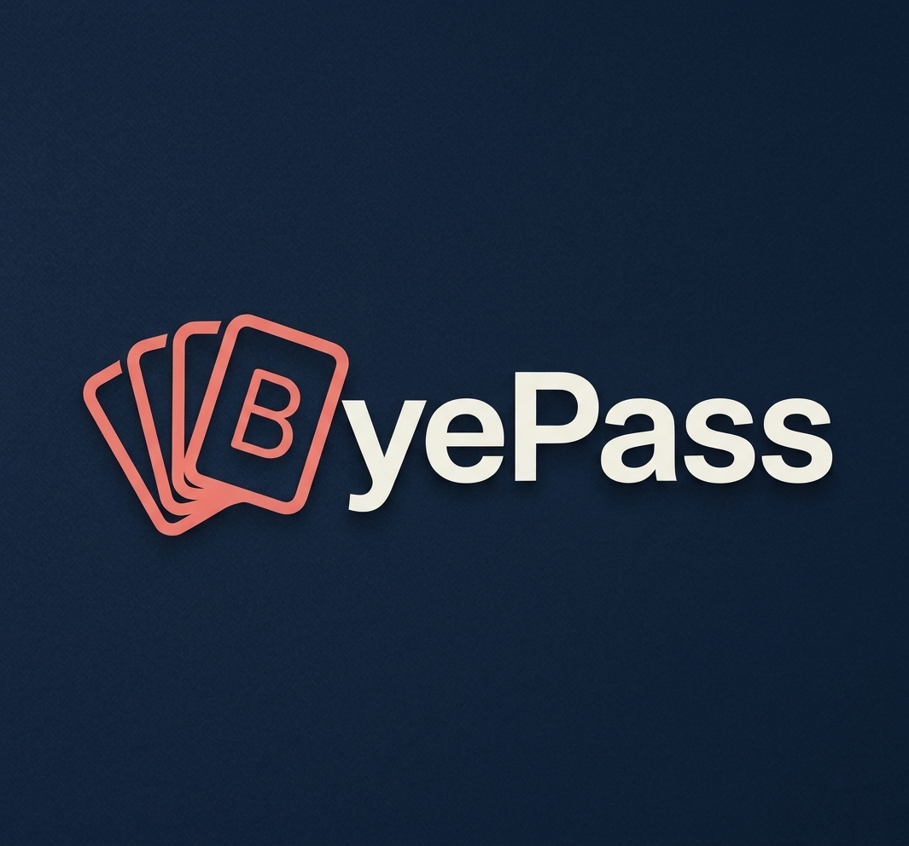
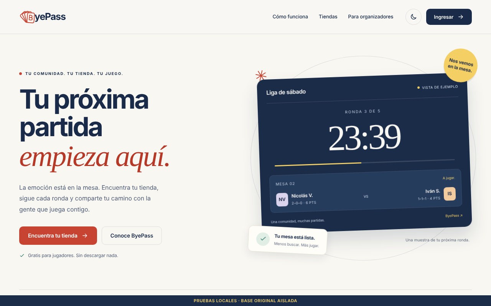
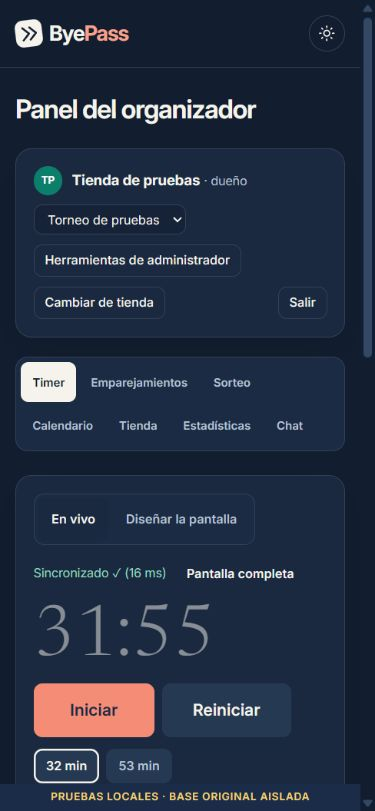
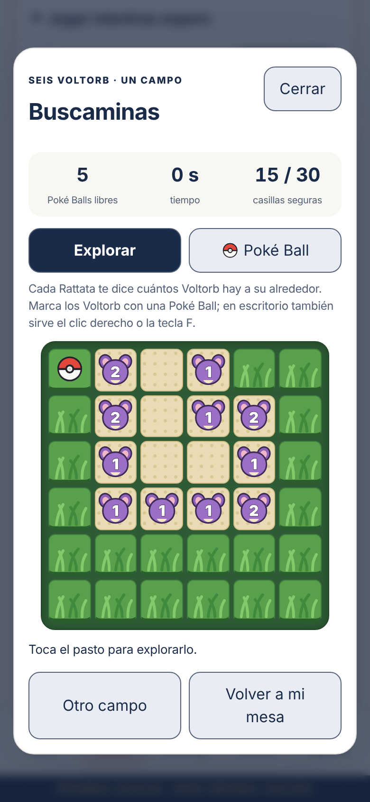
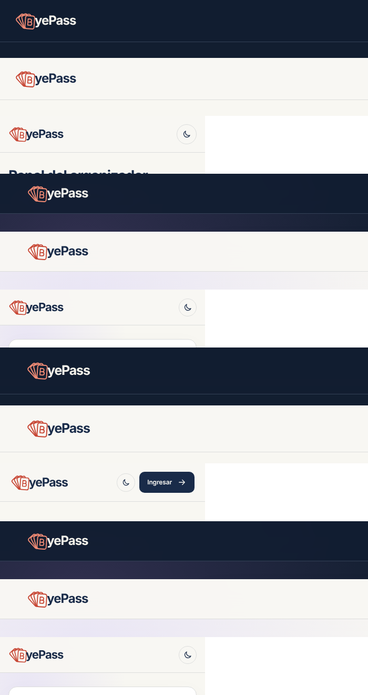
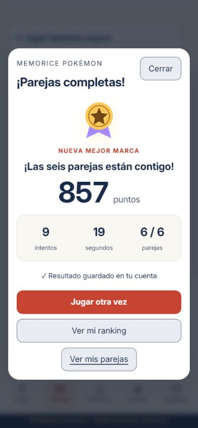
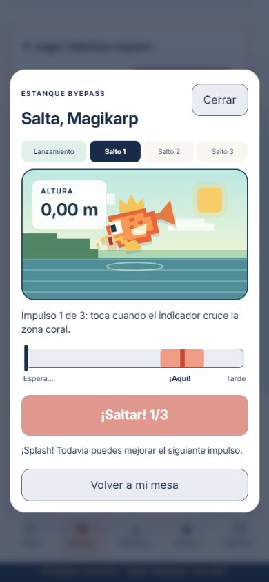
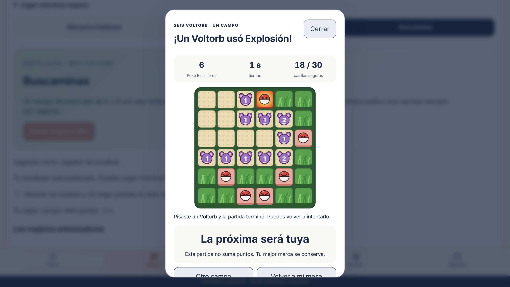

<p align="center">
  
</p>

# ByePass (mod)

> **Esto es un mod del proyecto original ByePass, creado por [nicolasvallejosrojas-hub](https://github.com/nicolasvallejosrojas-hub)** (repositorio `timertorneosbyepass`, sitio publicado en [byepass.cl](https://byepass.cl)).
> Todo el mérito de la aplicación base (timer, emparejamientos, tiendas, muro, rulings y el resto de las funciones) es de su autor. Este repositorio reúne una copia modificada que corre en un entorno local aislado, con un rediseño, correcciones, pruebas y funciones nuevas.
> No es la versión oficial y no está conectado al Firebase real del sitio.

ByePass es una web para la comunidad de juegos de cartas y sus tiendas. Los jugadores encuentran su tienda, siguen las rondas de un torneo desde el celular y guardan su historial. Los organizadores llevan el reloj, los emparejamientos, la clasificación y el sorteo desde un solo panel.

---

## Índice

1. [Qué hace la página](#qué-hace-la-página)
2. [Qué cambia este mod](#qué-cambia-este-mod)
3. [Cómo ejecutarlo](#cómo-ejecutarlo)
4. [Pruebas](#pruebas)
5. [Estructura del repositorio](#estructura-del-repositorio)
6. [Límites y pendientes](#límites-y-pendientes)
7. [Créditos](#créditos)

---

## Qué hace la página

### Para jugadores

| Pantalla | Archivo | Qué permite |
| --- | --- | --- |
| Portada | `web/index.html` | Presentación de ByePass, acceso a tiendas y a los rulings. El ingreso y el registro se abren en una ventana aparte. |
| Torneo en vivo | `web/timer-view.html` | Reloj de la ronda, mesas y rival, ranking del mes por categoría, sorteo, agenda de próximos torneos y minijuegos para la espera entre rondas. Se llega escaneando el QR de la tienda, sin cuenta. |
| Muro | `web/muro.html` | Página personal: próximo torneo, resultados, rachas, insignias, tiendas que sigues y lo que está en vivo ahora. |
| Cuenta | `web/cuenta.html` | Registro, ingreso, datos personales, ID de jugador en otros juegos, privacidad en las tablas públicas, mazos, contacto y borrado de la cuenta. |
| Tiendas | `web/tienda.html` | Tiendas verificadas con su perfil, fotos, organizadores, jugadores, timers, rifas, publicaciones, últimos torneos, clasificación y próximas fechas. |
| Inscripción | `web/inscripcion.html` | Inscribirse a un torneo con lista de mazo, respetando cupos. |
| Mis mazos | `web/mazos.html` | Guardar listas de mazo para reutilizarlas al inscribirse. |
| Rulings | `web/rulings.html` | Buscador de rulings de Pokémon TCG con filtros y traducción de apoyo al español junto al original en inglés. |
| Rifa | `web/rifa.html` | Premios y números disponibles de la rifa de una tienda. |
| Timer sin cuenta | `web/invitado.html` | Probar el timer por 24 horas sin registrarse: reloj en la tele, mesas en el celular y sorteo. |
| Términos y privacidad | `web/terminos.html`, `web/privacidad.html` | Reglas de uso y qué datos se guardan. |

### Para organizadores y tiendas

| Pantalla | Archivo | Qué permite |
| --- | --- | --- |
| Panel del organizador | `web/admin.html` | Pestañas de Timer (iniciar, pausar, tiempo extra por mesa, diseño de la pantalla), Emparejamientos (sistema suizo, resultados, top cut, publicación), Sorteo, Calendario, Tienda (perfil público, logo y color), Estadísticas y Chat con el staff. |
| Pantalla para la tele | `web/tele.html` | Reloj, mesas y sorteo a pantalla completa, manejable con el control remoto. |
| Staff | `web/staff.html` | Jueces y ayudantes entran con un código, el organizador los admite y ven el reloj, las mesas y el chat. |
| Afiches | `web/afiche.html` | Editor de afiches para redes en formato post (1080×1350) e historia (1080×1920). |
| Widget | `web/widget.html` | Próximos torneos y ranking del mes para incrustar en otra web. |

### Para administradores del sitio

| Pantalla | Archivo | Qué permite |
| --- | --- | --- |
| Herramientas | `web/herramientas.html` | Mantenimiento del sitio, avisos globales, limpieza, rulings, beta cerrada, salas de invitado, solicitudes y alta de tiendas, cuentas, correos y buzón de sugerencias. |
| Estadísticas | `web/estadisticas.html` | Cuentas, tiendas, torneos, visitas y partidas por período, con descarga en CSV. |

La aplicación es HTML, CSS y JavaScript sin framework. Usa Firebase Authentication y Realtime Database, y se instala como app (PWA) gracias a `manifest.webmanifest` y `sw.js`.

---

## Qué cambia este mod

<p align="center">
  
  
  
</p>

### 1. Entorno local aislado

- Copia independiente de la web en `web/`, servida por `scripts/server.mjs` en `http://127.0.0.1:8001` junto a los emuladores de Firebase (Auth 9099, Database 9000, panel 4000).
- Proyecto ficticio `demo-byepass` con datos y cuentas de prueba. El emulador es obligatorio: `?emu=0` no lo desactiva.
- La política de seguridad (CSP) del servidor local bloquea cualquier conexión al Firebase real, incluidos los enlaces cortos de `404.html`.
- Los datos se guardan y restauran entre sesiones. Hay un script para importar una exportación JSON solo a la base local, con respaldo previo.

Detalle: [ENTORNO-LOCAL.md](ENTORNO-LOCAL.md) y [ESTADO-ENTORNO.md](ESTADO-ENTORNO.md).

### 2. Rediseño visual de las 20 pantallas

- Paleta crema y azul profundo, coral para las acciones y detalles amarillos, lilas y menta.
- Temas claro y oscuro, foco visible, salto al contenido, movimiento reducido y revisión en anchos de celular.
- Sistema compartido de tokens (`web/tokens.css`, `web/sistema.css`) y una hoja por pantalla en `web/paginas/`.
- ByePass se presenta como comunidad de juegos y torneos en general. Las herramientas propias de un juego conservan su nombre.

Detalle: [REDISENO.md](REDISENO.md) y [ESTILOS.md](ESTILOS.md).

### 3. Nuevo logo

El abanico de cartas con la «B» reemplaza al logo de flechas, en las cabeceras de todas las pantallas y en los íconos de la app (`icono.svg`, `icono-192.png`, `icono-512.png`, `icono-apple.png`, `icono-mascara.png`). Está dibujado en SVG y toma el color de acción de cada tema.

<p align="center"></p>

### 4. Registro recuperable

- El registro distingue un rechazo confirmado de una interrupción con resultado incierto, y nunca borra una cuenta que quedó bien guardada.
- Una cuenta que quedó a medias se puede completar con el mismo usuario. La portada, la cuenta y el muro la reconocen y ofrecen terminarla.

Detalle: [REGISTRO.md](REGISTRO.md).

### 5. Torneos, inscripciones y seguridad

- El torneo y sus emparejamientos públicos se guardan en una sola escritura atómica (`web/admin-publicacion.js`). Si la confirmación no llega, el panel lo avisa y permite comprobar el estado.
- La inscripción, la plaza y el índice del dueño se escriben juntos (`web/inscripcion-datos.js`). En la prueba concurrente del último cupo entró exactamente una solicitud.
- Los errores de las acciones administrativas se muestran al usuario (`web/errores.js`).
- Parte de la lógica del panel salió de `admin.html` a `admin-panel.js` y módulos propios. Las versiones `?v=` de los recursos se calculan solas (`scripts/versionar.mjs`).
- El JSON de rulings pasó de 2,1 MB a unos 420 KB transferidos, gracias a compresión Brotli y caché por ETag.
- Laboratorios separados con reglas de seguridad candidatas (`rules/`) y tres Cloud Functions de reemplazo que generan avisos simulados (`functions/`).

Detalle: [SEGURIDAD-Y-TORNEOS.md](SEGURIDAD-Y-TORNEOS.md).

### 6. Identidad de cada tienda

En el panel, Tienda > Perfil público permite subir el logo de la tienda, propone su color dominante y lo aplica al perfil, al panel y a la vista del torneo, con contraste de texto automático. Detalle: [USABILIDAD.md](USABILIDAD.md).

### 7. Minijuegos para la espera entre rondas

En la vista del torneo, Mesas > Jugar mientras espero. Para jugar hay que tener cuenta y que el nombre del perfil coincida con un jugador de la ronda con resultado ya publicado. Cada juego tiene marca personal, historial y ranking optativo de 20 puestos. El servidor local calcula los puntajes: el navegador no puede enviar un puntaje ni elegir otra cuenta. Si empieza una ronda nueva, la partida se cierra.

| Juego | Cómo se juega | Detalle |
| --- | --- | --- |
| Memorice Pokémon | Encontrar seis parejas de cartas Full Art (TCGdex), con casillas del tamaño de una carta, en pocos intentos y poco tiempo. Al terminar aparece una pantalla de victoria. | [USABILIDAD.md](USABILIDAD.md) |
| Salta, Magikarp | Un lanzamiento y tres impulsos de precisión. La altura se calcula con las cuatro precisiones. | [MAGIKARP.md](MAGIKARP.md) |
| Buscaminas | Pasto alto de 6×6 con seis Voltorb escondidos. Los Rattata indican cuántos hay cerca y se marcan con Poké Balls. La primera casilla siempre es segura. Funciona con toque, clic derecho o teclado. | [BUSCAMINAS.md](BUSCAMINAS.md) |

<p align="center">
  
  
  
</p>

---

## Cómo ejecutarlo

Requisitos: Node.js 20 o superior y Java 21 (los emuladores de Firebase lo necesitan). En Windows puedes dejar un Java portátil en `tools/java/`, y el arranque lo detecta solo.

```powershell
npm ci                 # instala Firebase CLI local (firebase-tools)
npm start              # emuladores + web local; espera el mensaje "WEB LOCAL"
npm run seed           # en otra terminal, solo la primera vez: datos ficticios
```

- Web: http://127.0.0.1:8001
- Panel de emuladores: http://127.0.0.1:4000
- Panel de la tienda ficticia: http://127.0.0.1:8001/admin.html?sala=tienda-test

Las cuentas de prueba solo existen en el emulador:

| Rol | Correo | Contraseña |
| --- | --- | --- |
| Organizador y administrador | organizador@example.test | PruebaLocal2026! |
| Jugador | jugador@example.test | PruebaLocal2026! |

Para detenerlo, presiona Ctrl+C y espera a que Firebase exporte los datos a `data/snapshot/`. En Windows también puedes usar `iniciar.cmd` y `guardar.cmd`. Necesitas internet para los SDK de Firebase, las fuentes y las imágenes de cartas.

---

## Pruebas

| Comando | Qué comprueba |
| --- | --- |
| `npm run test:registro` | 17 casos de registro y recuperación. |
| `npm run test:sistema` | 6 casos de publicación, avisos y arreglos de Firebase. |
| `npm run test:usabilidad` | 11 casos de identidad de tiendas y espera entre rondas. |
| `npm run test:memoria` / `test:salto` / `test:minas` | Motores de los tres juegos (9, 8 y 8 casos). |
| `npm run test:memoria:api` / `test:salto:api` / `test:minas:api` | Juegos completos con cuentas reales del emulador: privacidad, reintentos, ranking y nueva ronda. |
| `npm run test:registro:emuladores` / `test:sistema:emuladores` | Laboratorios con reglas restrictivas, cupos concurrentes y un torneo completo. |
| `npm run verify:ui` | Hojas de estilo de las 20 páginas. |
| `npm run verify:cartas` | Nombre, rareza Full Art e imagen de las cartas del memorice en TCGdex (requiere internet). |
| `npm run verify` | Aislamiento, cabeceras, CRUD local y cuentas de prueba (con la web arrancada). |

`npm run verify` también compara la copia con los archivos originales. Si no tienes la carpeta del proyecto original junto a esta (`../timertorneosbyepass-main/`), esa parte falla. Lo mismo vale para `prepare.py`, que creó `web/` a partir del original.

---

## Estructura del repositorio

```
web/                 La aplicación modificada (lo que ve el usuario)
  paginas/           Una hoja CSS por pantalla
scripts/             Servidor local, arranque, datos, APIs de juegos y pruebas
functions/           Cloud Functions de reemplazo (solo emulador)
rules/               Reglas candidatas de los laboratorios restrictivos
database.rules.json  Reglas PERMISIVAS de la navegación local (no desplegar)
firebase*.json       Configuración de los emuladores
docs/                Logo, capturas e informe de evolución (.docx)
*.md                 Documentación de cada etapa
```

`data/` (copias de seguridad, exportaciones, marcas de los juegos y reportes) queda fuera de Git, porque puede tener datos personales.

---

## Límites y pendientes

Este mod **no está listo para reemplazar el sitio publicado**:

- `web/config.js` fuerza el emulador y solo funciona en localhost. `database.rules.json` permite leer y escribir todo. Ninguno de los dos debe publicarse.
- Las reglas candidatas de `rules/` no cubren todos los flujos: faltan alta de tiendas, invitaciones, salas anónimas, chat, mazos, insignias y otros nodos.
- No hay envío real de correos ni notificaciones push. Las funciones originales no estaban disponibles.
- Las cabeceras de seguridad (CSP, X-Frame-Options, HSTS) hay que aplicarlas en el alojamiento real. `web/_headers` es la versión para Netlify.
- Los rankings de los minijuegos usan un servidor Node local y un archivo en `data/`. Para publicarlos hace falta un backend autenticado. Hoy el jugador se vincula por el nombre del perfil, y falta hacerlo por UID.
- Queda pendiente medir en celulares reales, terminar de dividir `admin-panel.js` y sumar pruebas de top cut, importación y edición simultánea.

El informe completo está en [docs/ByePass_Informe_de_evolucion_y_pendientes.docx](docs/ByePass_Informe_de_evolucion_y_pendientes.docx).

---

## Créditos

- **Proyecto original:** ByePass, de [nicolasvallejosrojas-hub](https://github.com/nicolasvallejosrojas-hub) ([byepass.cl](https://byepass.cl)). El código base y la idea son de su autor.
- **Mod:** [CitriCool](https://github.com/CitriCool), con ayuda de asistentes de IA.
- Las ilustraciones de cartas del memorice vienen de [TCGdex](https://tcgdex.dev). Pokémon y sus nombres pertenecen a sus respectivos titulares. Este proyecto no está afiliado a ellos.
